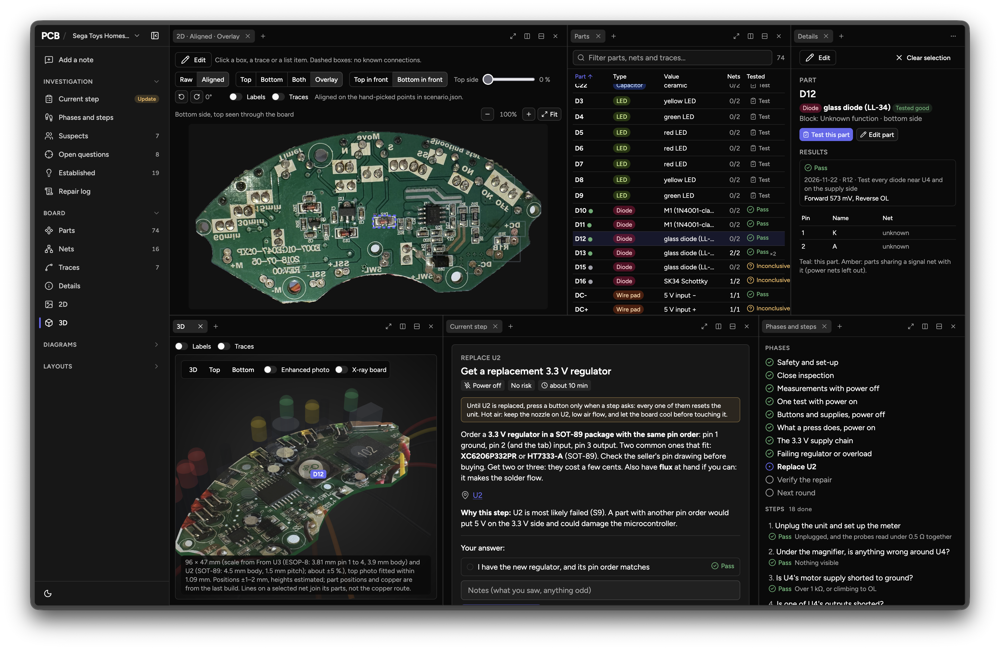
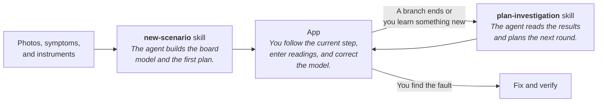

# PCB Repair Workbench

**Fix a broken circuit board with an AI agent as your repair expert.**

Photograph the board and describe the fault. You get a board model, a schematic, and a step-by-step investigation plan that tells you where to put the probes, what a working board reads, and what to do next. You don't need a schematic, a service manual, or any repair experience.



<p align="center"><em>A real repair: a Sega Toys Homestar Flux planetarium that resets when its motor starts.<br />The plan has narrowed the fault down to the 3.3 V regulator.</em></p>

## How the work is split

Most consumer electronics ship without a schematic. To find a fault, a repair technician reverse-engineers the board, reasons about what could fail, and measures the cheapest and safest things first. This approach takes years of experience to learn.

This tool splits that work between an agent and you:

- **The agent does the reasoning.** Claude Code uses the two skills in this repository to read your photos, identify the parts, trace the connections it has evidence for, and write the investigation plan. After each round of measurements, it reads your results and plans the next round.
- **You do the hands-on work.** The app shows you the board, the plan, and the next step, and it records every reading. The app makes no decisions of its own: every step that it shows includes the reason that the agent wrote for it.

Each scenario is stored as plain JSON files in this repository. As a result, every diagnosis is versioned and reviewable, and any agent session can resume it.

## Features

The workbench provides the following:

- **A board model built from photos.** The build removes the background from the photos of both sides, corrects their perspective, and aligns them in one frame, so you can see the top side through the bottom side. Each part has a box on the photos, a list of pins, and the nets that it connects to.
- **A confidence level for every connection.** Each connection records its evidence and one of five confidence levels. From most to least certain, the levels are `measured`, `confirmed`, `photo`, `datasheet`, and `assumed`. A net is only as certain as its least certain connection, and the schematic draws unverified wires as dashed lines.
- **A schematic, a netlist, and a block diagram.** The build generates them every time that you save, exports the schematic to KiCad, and runs the KiCad electrical rules check.
- **A 3D view of the board.** The 3D view is built from the photos, so you can quickly find a part on the physical board.
- **An investigation plan structured as a decision tree.** Each step explains why it's needed, its risk level (power off, low voltage, or mains), and how long it takes. It also describes the setup, where to place the probes, and which readings mean pass or fail. Your answer determines the next step.
- **A repair log.** The log keeps every observation, measurement, and instruction, and you can only add to it. The agent keeps the list of suspects, established facts, and open questions up to date.
- **A customizable workspace.** The photos, the 3D view, the parts and nets lists, the schematic, the plan, and the log are each a panel. You can open any number of each panel, arrange them side by side, and use a light or dark theme.

## Repair workflow

A repair alternates between the agent, which plans, and you, who measure in the app. The following diagram shows the cycle:



To repair a board, follow these steps:

1. Photograph both sides of the board, as straight on as possible, and take close-up photos of the chip markings. Write down the symptoms, what you've already tried, and which instruments you have. You need at least a multimeter.
2. In this repository, ask Claude Code to create a scenario from your photos. Claude Code uses the [`new-scenario` skill](.claude/skills/new-scenario/SKILL.md) to ask for a name, the fault, your observations, and your instruments. It then creates the `scenarios/<scenario-id>/` folder, which contains the following:
   - Every part that the agent can identify, with its box on the photos.
   - The connections that the agent has evidence for.
   - The open questions.
   - The schematic.
   - The first investigation plan.
3. Start the app, open the scenario, and go to the **Current step** panel. For each step, complete the setup, take the measurement, and enter the reading. If the reading falls in a range that the plan defines, the app preselects the matching answer. The app then moves to the step that your answer leads to.
4. Update the board model with what you learn. For example, correct a mislabeled part, draw a missing trace, or mark a connection that you checked with the multimeter. To pass information to the agent, add observations and instructions in the **Repair log** panel.
5. When the app marks the plan as out of date, run the following command in Claude Code. The app marks the plan as out of date when a branch ends, or when the model or the log changes.

   ```text
   /plan-investigation scenarios/<scenario-id>
   ```

   Replace `<scenario-id>` with the name of the scenario folder. The [`plan-investigation` skill](.claude/skills/plan-investigation/SKILL.md) keeps the checks that are still valid, updates the suspects, and plans the next round.

6. Repeat steps 3 to 5 until you find, fix, and verify the fault.

The order of the steps in a plan follows explicit rules, based on [how repair technicians find faults](docs/research/board-repair-diagnosis.md): safety first, power-off checks before power-on checks, and cheap, safe checks before invasive ones.

## Quickstart

### Before you begin

Install [Docker](https://docs.docker.com/get-docker/). To create and plan your own scenarios, you also need [Claude Code](https://docs.anthropic.com/en/docs/claude-code).

### Run the app

1. From the root of the repository, build the image and start the app:

   ```sh
   make start
   ```

   The app runs at http://localhost:8080.

2. In your browser, open http://localhost:8080 and select a scenario.
3. To stop the app, run the following command:

   ```sh
   make stop
   ```

The app reads scenarios from the `scenarios/` folder. To use a different folder, set the `SCENARIOS` variable:

```sh
SCENARIOS=/path/to/folder make start
```

To work on the app itself with live reload, run `make dev`.

### Explore the example

The [`scenarios/homestar-flux`](scenarios/homestar-flux/) folder holds the repair shown in the screenshot, which is still in progress. Open it in the app to follow a full investigation, from the first visual inspection to the replacement of the failed part. You can also read its [investigation report](scenarios/homestar-flux/exports/investigation.md) and [schematic](scenarios/homestar-flux/exports/schematic.svg) directly on GitHub.

## How it works

Each board is a _scenario_: a folder that contains three JSON files and the photos that they refer to. Only one party writes each file, as described in the following table:

| File            | Contents                                                                                                           | Written by                                                   |
| --------------- | ------------------------------------------------------------------------------------------------------------------ | ------------------------------------------------------------ |
| `scenario.json` | The board: parts, pins, nets, photos, 3D geometry, instruments, and the confidence and evidence of each connection | The agent when it creates the scenario, then you, in the app |
| `plan.json`     | The investigation plan: phases, the tree of steps, suspects, and findings                                          | The agent only                                               |
| `record.json`   | Observations, instructions, and results                                                                            | You, through the app. Entries are never edited, only voided. |

The build, written in Python with OpenCV, validates the three files against their JSON schemas. It then generates the netlist, the block diagram, the KiCad schematic, the investigation report, and the data for the app.

The app uses React and three.js, served by a Node.js server with no dependencies. The app saves your edits only when the build accepts them, and it never overwrites a file that an agent changed since the page loaded it.

For more information, see the following documents:

- [Scenario format](docs/scenario-format.md): the three files, the plan's tree, and what the build checks.
- [Architecture](docs/architecture.md): how the components call each other.
- [App reference](app/README.md): the viewer, the editors, the server, and the schematic rules.
- [Agent guidance](AGENTS.md): the structure, design decisions, and commands for coding agents.

## Repository layout

The repository contains the following top-level files and folders:

| Path              | Contents                                                                                                                             |
| ----------------- | ------------------------------------------------------------------------------------------------------------------------------------ |
| `app/`            | The tool: the schemas, the build scripts, the server, and the app                                                                    |
| `.claude/skills/` | The `new-scenario` skill, which builds a scenario from photos, and the `plan-investigation` skill, which writes and updates its plan |
| `scenarios/`      | The scenarios, one folder each. `homestar-flux/` is a Sega Toys Homestar Flux planetarium that resets when its motor starts.         |
| `docs/`           | The scenario format, the architecture, and research on how repair technicians find faults                                            |
| `Makefile`        | The `build`, `start`, `stop`, `dev`, and `check` targets                                                                             |
| `AGENTS.md`       | Guidance for coding agents                                                                                                           |
