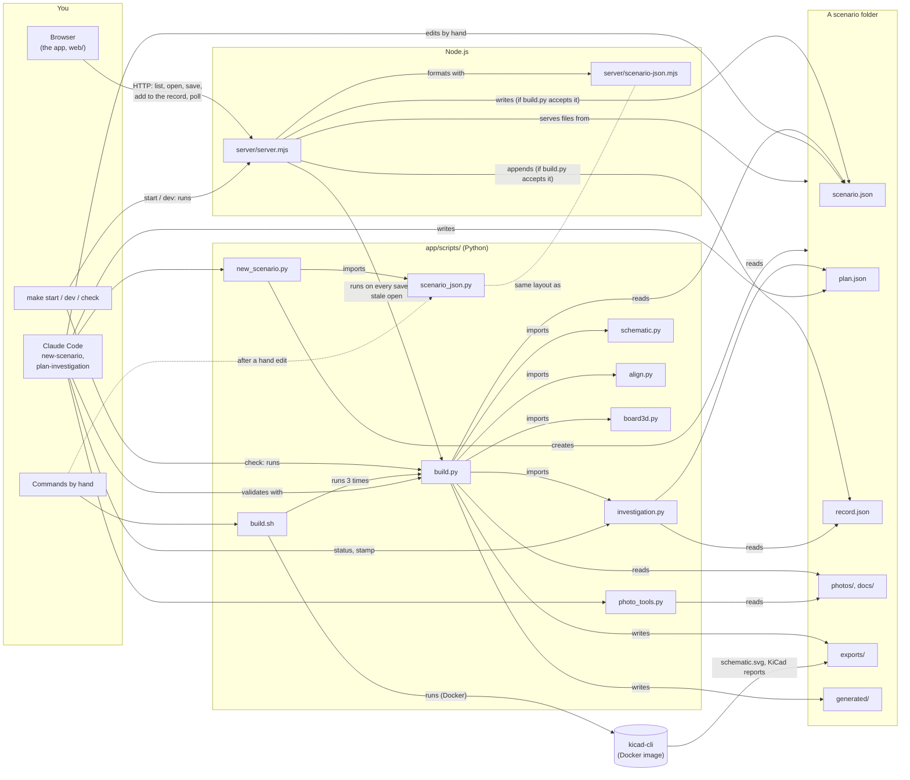
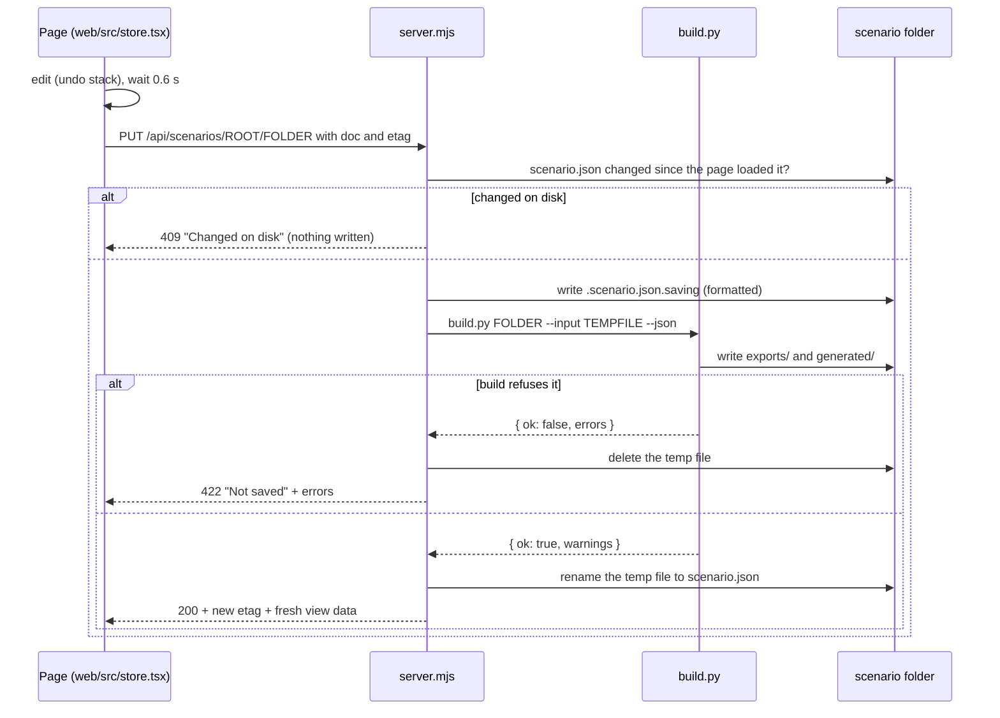

# How the pieces call each other

Three ways in: the **app** (in the browser), **commands you type** (Make, scripts), and the **agent** (the `new-scenario` and `plan-investigation` skills). They all end up reading or writing the same thing: a scenario folder. Its three files have one writer each: `scenario.json` (the agent creates it, the app edits it), `plan.json` (the agent only) and `record.json` (the app only, add-only).

## The whole picture



## Who runs what

| Script                     | Run by                                                                                                      | Does                                                                                   |
| -------------------------- | ----------------------------------------------------------------------------------------------------------- | -------------------------------------------------------------------------------------- |
| `server/server.mjs`        | `make start` (the image's command), `make dev`                                                              | Lists, serves and saves scenarios; appends to the record; serves the app               |
| `scripts/build.py`         | The server (every save and record entry; opening a stale scenario), `make check`, `build.sh`, `ui-test.mjs` | Validates a scenario; writes `exports/` and `generated/`                               |
| `scripts/investigation.py` | Imported by `build.py`; by the agent (`status`, `stamp`, `check`); `ui-test.mjs`                            | Checks and walks the plan, derives suspects and part states, writes `investigation.md` |
| `scripts/schematic.py`     | Imported by `build.py` only                                                                                 | The KiCad schematic and its layout rules                                               |
| `scripts/align.py`         | Imported by `build.py` only                                                                                 | Photo processing: background removal, perspective, front and back alignment (cached)   |
| `scripts/board3d.py`       | Imported by `build.py` only                                                                                 | 3D geometry and textures                                                               |
| `scripts/build.sh`         | Only by hand                                                                                                | `build.py`, then KiCad (SVG, netlist round trip, ERC), then `build.py` again           |
| `scripts/new_scenario.py`  | By hand, or the agent (skill step 2)                                                                        | Creates a scenario folder from photos                                                  |
| `scripts/photo_tools.py`   | By hand, or the agent (skill steps 3 and 5)                                                                 | Coordinate grids and box overlays on a photo                                           |
| `scripts/scenario_json.py` | Imported by `new_scenario.py` and `investigation.py`; by hand after editing a file                          | Writes the three files in the standard layout                                          |
| `scripts/migrate_v2.py`    | Only by hand, once per scenario in the earlier format                                                       | Moves the repair log and tests to `record.json`                                        |

Nothing runs automatically except `build.py`, and only through the server or `build.sh`.

## What happens when you edit in the app



Opening a scenario (`GET /api/scenarios/<id>`) runs `build.py` first only if `scenario.json` or one of the scripts is newer than `generated/`, for example after an agent edited the file, and only its light `--investigation` check when just `plan.json` or `record.json` changed.

## One round of the investigation

```mermaid
sequenceDiagram
  participant U as You (the app)
  participant S as server.mjs
  participant R as record.json
  participant A as Agent (plan-investigation)
  participant P as plan.json

  U->>S: answer a step, add an observation or an instruction
  S->>R: append (numbered R1, O1, I1...), after build.py --investigation accepts it
  U->>U: walk the tree to the next step; apply the answer's effects
  Note over U: the plan says it needs an update<br/>(a replan step, a new note, a model change...)
  A->>A: investigation.py status (path, new results, model changes, instructions)
  A->>P: write the next revision (keeps the walked steps' ids)
  A->>A: investigation.py stamp (based_on, strict check)
  U->>S: poll the files' versions (every 3 s)
  S-->>U: the new plan.json: the tree continues from where you stand
```

## Outside the scenario folder

- `app/schema/` holds the three schemas, read by `build.py` and `investigation.py`.
- `.claude/skills/plan-investigation/reference/` holds what the agent applies: the process, the step-writing rules and a protocol library (checked by `tests/test_investigation.py`).
- `app/web/` is built by Vite into `app/web/dist/`, which the server serves. In `make dev`, Vite serves the app itself and forwards `/api` and `/files` to the server.
- `app/tests/` start their own server (`tests/server.mjs`) on a temporary copy of `scenarios/homestar-flux`.
