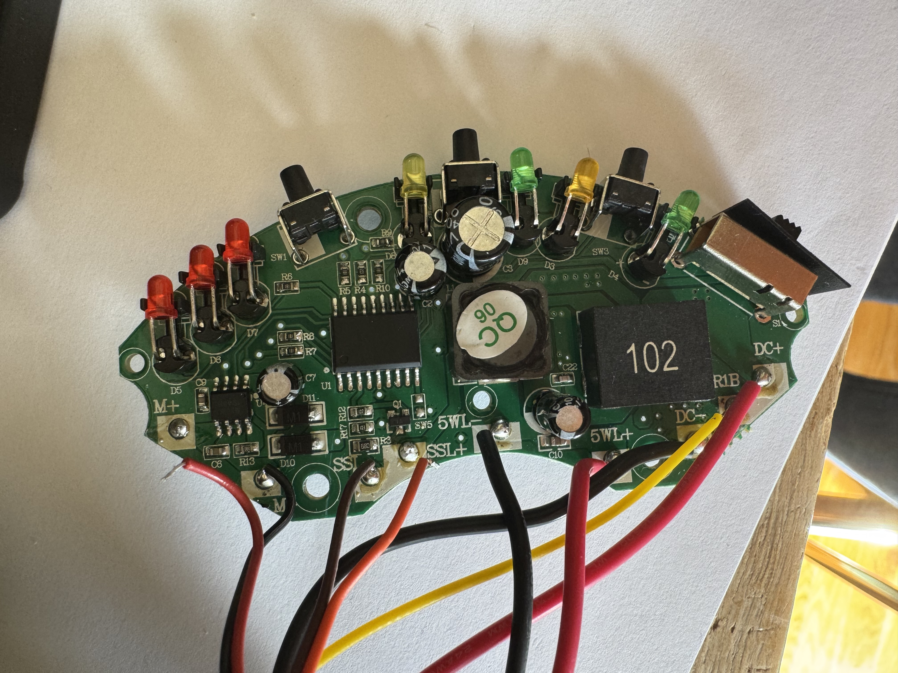
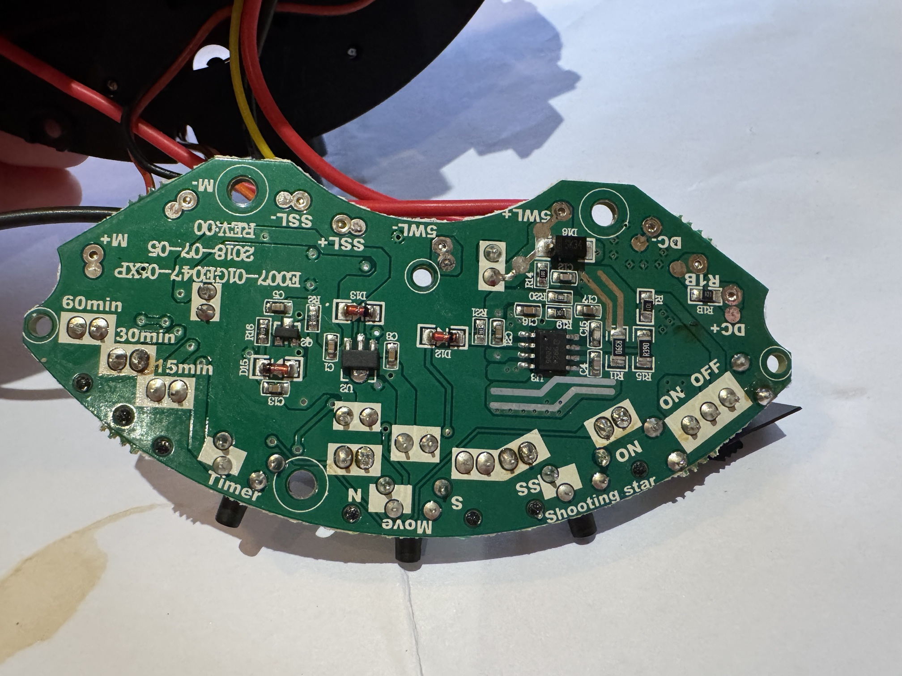

# Sega Homestar Flux repair

A scenario: the repair of a Sega Toys Homestar Flux home planetarium whose rotation and shooting-star functions stopped working.

**Status:** under investigation. The plan, the suspects and the next steps are in the app's **Investigate** layout (`plan.json`); everything observed and measured is in the **Repair log** panel (`record.json`). Both are exported to [exports/investigation.md](exports/investigation.md). The repair log as it was before this format is in [docs/repair-log-v1.md](docs/repair-log-v1.md).

## The device

The Homestar Flux (Sega Toys, 2018) is an optical home planetarium developed with planetarium creator Takayuki Ohira. A 5 W LED projects a star disc onto the ceiling, powered by a 5 V/2 A USB adapter. Its functions:

- **Move:** rotates the sky (diurnal motion), anticlockwise (N) or clockwise (S)
- **Shooting Star:** a shooting star about every 30 seconds while the sky rotates
- **Timer:** auto-off after 15, 30 or 60 minutes (otherwise after about 3 hours)

## The problem

- The main lamp turns on and projects the star map normally.
- Pressing **Move** or **Shooting Star** makes the lamp blink for a split second. The function's LED flashes, then goes out, and nothing else happens.
- The rotation motor never turns, and the belt is intact.
- Changing the power adapter (5 V/2 A or 5 V/4 A) makes no difference.

## This folder

| Path                    | Contents                                                                                                             |
| ----------------------- | -------------------------------------------------------------------------------------------------------------------- |
| `scenario.json`         | The board model: parts, nets with the confidence of every connection, photos, open questions, 3D fit, instruments    |
| `plan.json`             | The investigation plan, written by the `plan-investigation` skill                                                    |
| `record.json`           | Observations, instructions and results, entered in the app                                                           |
| `photos/`               | Board photos (`top-*`, `bottom-*`) and part close-ups (`parts/`)                                                     |
| `docs/manual.pdf`       | Official manual (English and German), SporsPartners GmbH & Co. KG, 2018                                              |
| `docs/B07JB9Q3FW.pdf`   | Third-party instruction page from Manuals+; unofficial, some specs conflict with the official manual                 |
| `docs/repair-log-v1.md` | The repair log in its earlier form, kept for reference                                                               |
| `exports/`              | Generated: `investigation.md`, `netlist.md`, `block-diagram.svg`, `schematic.kicad_sch`, and `schematic.svg` (KiCad) |
| `generated/` (ignored)  | The viewer's data, rebuilt from the rest                                                                             |

Open it in the viewer (`make start` at the repository root, then http://localhost:8080), or read [`exports/netlist.md`](exports/netlist.md).

## Board reference

Main board marking: `E007-01GE047-02XP`, `REV:00`, `2018-07-05`.

| Top side                             | Bottom side                                |
| ------------------------------------ | ------------------------------------------ |
|  |  |

- **Top side:** buttons, LEDs, inductors, U1 (18-pin) and U4 (8-pin).
- **Bottom side:** silkscreen labels for the pads and buttons, U2, U3 and most small parts.

| Pads            | Connection                           |
| --------------- | ------------------------------------ |
| `DC+` / `DC-`   | 5 V input from the USB cable         |
| `5WL+` / `5WL-` | Main 5 W LED                         |
| `SSL+` / `SSL-` | Shooting-star LED                    |
| `M+` / `M-`     | Rotation motor (brushed DC, 2 wires) |
| `R1B`           | Yellow wire; 100 Ω (`R1B`) to `DC+`  |

- **Power switch:** hard ON/OFF slide switch.
- **Microcontroller:** U1, an unmarked 18-pin chip in the middle of the top side.
- **Motor driver:** U4, Mixic MX08L (marked `MX08L 1949H`), next to `M+` on the top side, with a 47 µF 16 V electrolytic beside it. Pinout: 1 VCC (logic supply), 2 INA, 3 INB, 4 VDD (motor supply), 5 OUTB, 6 and 7 GND, 8 OUTA. Both inputs low: outputs off; one high: forward or reverse; both high: brake. Datasheet: [LCSC C5119041](https://lcsc.com/product-detail/Brushed-DC-Motor-Drivers_Mixic-MX08L_C5119041.html).
- **Main LED driver:** U3, 8-pin, bottom side, marked `D9924 2006` (likely a QX9924 step-down LED driver; read from `parts/IMG_3631`), with an SK34 Schottky diode (D16) and two `R390` (0.39 Ω) current-sense resistors. Works.
- **3.3 V regulator:** U2, marked `6206A` / `33`, bottom side, near the motor and shooting-star pads.
- **Transistors:** Q1 (top side, by the shooting-star pads, with a 68 Ω resistor R3, likely the shooting-star LED driver) and Q2 (bottom side, by R16). Both are SOT-23 parts marked `Y1`, commonly an SS8050 NPN.
- **Other parts near the motor and shooting-star pads (bottom side):** glass diodes D12, D13 and D15, capacitors C1, C5, C8 and C13.
- **Front panel:** Timer (15/30/60 min LEDs), Move (N/S LEDs), Shooting Star (SS LED), ON LED.

### Close-ups

| Photos                                                                                                              | Shows                                                               |
| ------------------------------------------------------------------------------------------------------------------- | ------------------------------------------------------------------- |
| [IMG_3619](photos/parts/IMG_3619.jpg), [IMG_3620](photos/parts/IMG_3620.jpg)                                        | U4 (MX08L) and its 47 µF capacitor, next to `M+`                    |
| [IMG_3621](photos/parts/IMG_3621.jpg), [IMG_3622](photos/parts/IMG_3622.jpg)                                        | Electrolytic capacitors (220 µF, 470 µF)                            |
| [IMG_3623](photos/parts/IMG_3623.jpg)                                                                               | Round shielded inductor                                             |
| [IMG_3624](photos/parts/IMG_3624.jpg), [IMG_3625](photos/parts/IMG_3625.jpg)                                        | Large `102` inductor and a 100 µF capacitor, near `5WL`             |
| [IMG_3626](photos/parts/IMG_3626.jpg)                                                                               | U1 (unmarked) and Q1                                                |
| [IMG_3627](photos/parts/IMG_3627.jpg), [IMG_3628](photos/parts/IMG_3628.jpg), [IMG_3631](photos/parts/IMG_3631.jpg) | U3, D16 (SK34), the `R390` resistors and the `DC+`/`DC-`/`R1B` pads |
| [IMG_3629](photos/parts/IMG_3629.jpg), [IMG_3630](photos/parts/IMG_3630.jpg)                                        | U2, Q2, D12, D13 and D15                                            |
| [IMG_3632](photos/parts/IMG_3632.jpg)                                                                               | Q1 and R3 (68 Ω), by the shooting-star pads                         |

## Model status

45 of the 133 modelled pins are on a net, and most connections are **hypotheses from photos**. Measure before relying on any of them.

- **3D fit:** the top photo maps onto the board through 13 points seen on both photos (worst residual 1.16 mm, at `DC-`). The scale comes from the package sizes of U2 and U3 (about ±5 %); setting `geometry.board_width_mm` to a measured width replaces it.
- **KiCad checks (2026-11-07):** the netlist KiCad derives from the generated schematic matches the model on all 16 nets. ERC: 162 findings, all expected: 88 `pin_not_connected` (exactly the 88 unknown pins), 69 `lib_symbol_issues` (symbols embedded in the schematic rather than in a library), 3 `power_pin_not_driven` (the supply is off-sheet) and 1 `label_dangling` (`5WL-`, a net whose only known member is the pad).

## What the tracing found

New facts from the photos, beyond the repair log:

- **Input wiring:** a wire is soldered into one hole of each of `DC+` (red), `DC-` (black) and `R1B` (yellow); the leads are visible from the bottom in `parts/IMG_3631`. The 100 Ω resistor `R1B` (`101`) bridges the `R1B` pad and `DC+`. What the yellow wire carries is unknown (OQ6).
- **U3** reads **`D9924 2006`** in `parts/IMG_3631`, not `9624`. This most likely is a QX9924, a step-down LED driver with a built-in switch; its exposed pad is the switch node. The pin order isn't confirmed, so U3's pins aren't modelled.
- **5 W LED:** the `5WL+` wire lead is bent along a tinned strip that runs to D16's (SK34) cathode (`parts/IMG_3628`).
- **Motor area:**
  - The capacitor across the motor pads is **C6** (its label is upside down in `parts/IMG_3619`; C8 is on the bottom, beside U2). Traces in a contrast-enhanced close-up run from each end of C6 to the `M+` and `M-` pads.
  - A trace runs from U4 pin 5 (OUTB) to `M+`, and one from pin 8 (OUTA) to R13 (0 Ω). That R13's other end goes to `M-` is still only placement.
  - C9 sits against U4 pin 4 (VDD); no trace followed.
- **U4 orientation:** with its text upright, pin 1 (dimple) is bottom-left, by the `U4` label. Pins 1–4 face the 47 µF capacitor C7.
- **Front panel:** 7 LEDs (D3–D9: 3 red for the timer, 2 yellow, 2 green), 3 push-buttons (SW1–SW3) and the slide switch S1. SW5 is an empty footprint next to Q1.
- **Electrolytic next to `102`:** it is **C11** (100 µF); C10 is the small SMD part below it.

**Audit (2026-11-08).** Four connections were labelled `photo` on placement alone: C1 to U2 pin 3, C9 to U4 pin 4, R13 to `M-` and R3 to `SSL-`. They are now `assumed`, and only connections backed by a followed trace, copper area or soldered wire count as verified.

## Open questions

The [open questions](exports/netlist.md#open-questions) list the measurements that would settle the gaps that matter for the fault. The first three:

1. **OQ1:** where U4's motor supply (pin 4) comes from. Its short is what resets the unit.
2. **OQ2:** whether U4's logic supply (pin 1) is on 3.3 V or 5 V. If it's on 3.3 V, a U4 fault pulls the MCU supply down directly.
3. **OQ3:** which U1 pins drive U4's inputs, so you can watch them on a scope.

To record a result, open the part in the viewer's editor and set that pin's net and confidence (`measured`), with the reading as its evidence; it is saved to `scenario.json`.

## Limits

- **Photos only show the surface:** traces under parts and through vias can't be followed, so most links between the two sides are missing.
- **U1 is unmarked:** its pin functions can only be learned by tracing or measuring.
- **Unverified pinouts:** the MX08L pinout comes from the repair log, and the 6206 and SOT-23 pinouts are the common ones for those packages. None of these has been checked against the actual part's datasheet.
- **Approximate positions:** part boxes on the photos were placed partly from an automated component detector's output and partly by hand.

## Safety

Everything inside runs off the external 5 V adapter, so there is no mains voltage in the unit. Mind the bright 5 W LED when the case is open.
